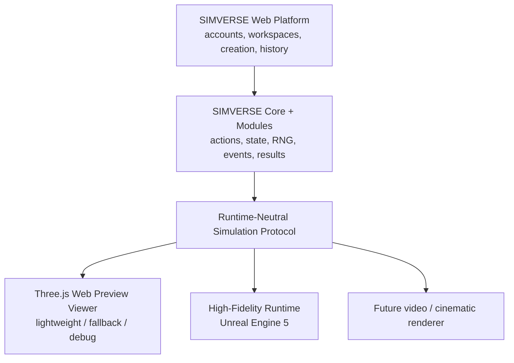

# SIMVERSE High-Fidelity Experience Runtime

> **Status:** Phase 6.5 architecture decision, 2026-09-19. This document defines
> direction and phase boundaries. It does not represent an implemented runtime.

## 1. Decision

Use **Unreal Engine 5** for the first SIMVERSE High-Fidelity Experience Runtime.
Keep the existing Three.js implementation as the **SIMVERSE Web Preview Viewer**.
Connect both to SIMVERSE through a versioned, engine-neutral Runtime Protocol.

The recommendation is deliberately asymmetric:

- Next.js remains the product and creator platform.
- SIMVERSE Core and Simulation Modules remain authoritative.
- Unreal is a downstream presentation runtime.
- Three.js remains a useful lightweight presentation runtime.
- The protocol is the durable product boundary; Unreal is the first premium
  implementation of that boundary, not part of the protocol itself.

No Unreal project is created in Phase 6.5.

## 2. Non-negotiable authority boundary



Core and Modules determine whether an action occurred, its actor and target,
damage, critical/dodge/defend state, elimination, ordering, ranking and result.
The presentation runtime may select a compatible animation variant, path shape,
camera, lighting treatment, sound, VFX and secondary physics. It may never use
those choices to revise authoritative Run truth.

This remains true if a future Module makes physical simulation authoritative.
That Module must explicitly own and persist the relevant physical state. Unreal
physics does not acquire authority implicitly.

## 3. Engine evaluation

### Recommendation: Unreal Engine 5

Unreal provides the most direct route to the requested quality class:

- Nanite, Lumen, Virtual Shadow Maps and a strong material/post-processing stack
  for high-detail scenes and cinematic lighting.
- Landscape, foliage/PCG, World Partition, Data Layers, HLOD and level instancing
  for environments ranging from arenas to large cities and natural biomes.
- Skeletal Meshes, Animation Blueprints, state machines, Blend Spaces, montages,
  Control Rig, IK Rig/Retargeter, Motion/Pose Warping and Motion Matching.
- Chaos for presentation physics and vehicle/cloth/destruction possibilities.
- Niagara for data-driven VFX; Audio Mixer and MetaSounds for interactive audio.
- Sequencer and Cine Camera tooling for intros, replays and results.
- The Gameplay Framework, replication and dedicated-server tooling if a later
  approved product requires networked or multi-user runtime sessions.
- C++, Blueprints, Data Assets, commandlets and Automation Tool for a blend of
  programmatic systems, artist iteration and automated builds.
- Packaged desktop runtimes and Pixel Streaming/WebRTC for premium browser
  delivery without pretending the full renderer is ordinary browser JavaScript.
- A large production ecosystem for environments, characters, animation,
  virtual production and technical art.

The same skeletal-animation foundation can serve humanoids, animals and custom
creatures through different rigs and archetype profiles. Chaos Vehicles covers
ground-vehicle presentation; air and water vehicles need purpose-built movement
and content systems. Engine features do not supply production-quality models,
rigs, animation or world art, so the content pipeline remains the largest risk.

Costs and constraints are material. Unreal requires a heavyweight editor,
specialist technical-art workflows, large assets and builds, capable developer
hardware, binary-content source control, shader/cook time and engine-version
discipline. Premium cloud delivery adds GPU capacity, session orchestration,
video encoding and bandwidth cost.

Licensing must be reviewed again before commercial release. As verified on
2026-09-19, Epic's standard terms distinguish royalty products from seat-based
uses. Its public license page states a 5% royalty on lifetime gross revenue over
USD 1 million attributable to a royalty product, while some non-royalty
commercial uses above the indie threshold require paid seats. Product counsel
must classify native distribution, subscription access and cloud streaming for
SIMVERSE before launch; this document is not legal advice.

### Viable alternative: Unity 6

Unity is credible for cross-platform native applications, C# productivity,
HDRP, Animator/Animation Rigging, Timeline/Cinemachine, VFX Graph, physics,
terrain and a broad asset ecosystem. It may be preferable if team availability,
mobile reach or C# iteration becomes the dominant constraint.

It is the second choice for this target because the shortest route to the
specific high-end world, cinematic, character and streamed-runtime goal is
stronger in Unreal's integrated toolchain. Choosing Unity would also require a
separate evaluation of the cloud-streaming stack rather than inheriting Unreal's
Pixel Streaming path. Unity's official 2026 pricing requires Pro above USD
200,000 in annual revenue and funding, and the former Runtime Fee is cancelled.

### Viable open-source alternative: Godot 4

Godot is MIT licensed, open source, lightweight and gives SIMVERSE maximum
control. It supports modern 3D rendering, lighting, particles, navigation and
LOD/HLOD techniques. It is a good candidate for smaller native clients or
specialized open runtime needs.

For the initial premium proof, Godot would require more custom production work
around AAA-scale character animation, world tooling, cinematics, high-end asset
pipelines and managed browser streaming. Its licensing advantage does not offset
that schedule and content risk for the stated reference scenario.

### Web-native engines

Three.js, Babylon.js and future WebGPU stacks preserve instant browser access,
but the current constraint is the finished experience and content pipeline, not
whether JavaScript can draw 3D. A web-native premium runtime would require
SIMVERSE to build or integrate more of the world, animation, asset cooking,
cinematic and quality-scaling stack itself while still depending on variable
client hardware. Three.js therefore remains the Preview tier.

### Decision review triggers

Re-evaluate before production commitment if licensing changes materially, Pixel
Streaming becomes unsuitable, the available team is strongly specialized in a
different engine, target platforms change, or the bounded proof cannot meet its
quality/performance budget. The protocol prevents that review from forcing a
Core rewrite.

## 4. Runtime architecture

The Unreal project should be built from separable runtime subsystems:

1. **Runtime Host:** startup, command-line/deep-link parameters, session state,
   loading screen, failure recovery and return-to-platform flow.
2. **Protocol Client:** retrieves, validates and normalizes a completed Runtime
   Package; rejects unsupported or corrupted versions safely.
3. **Asset Resolver and Cache:** resolves immutable asset-version references,
   checks hashes, downloads permitted bundles and selects fallback content.
4. **World Loader:** resolves a versioned World binding, Data Layers, spawn zones,
   navigation/camera zones, lighting/weather preset and ambient profile.
5. **Entity Factory:** turns participant snapshots into runtime actors through
   archetype presenters and Visual Asset bindings.
6. **Timeline and Presentation Scheduler:** consumes ordered authoritative events
   and invokes presentation cues without recalculating outcomes.
7. **Animation Runtime:** locomotion state machines, action montages, additive
   reactions, IK, warping, completion and semantic fallbacks.
8. **Presentation Physics:** secondary motion, cloth, particles, debris and
   post-outcome ragdoll constrained by authoritative state.
9. **Camera Director:** deterministic event-aware shot selection, shot safety,
   framing, transitions and future AI-assisted suggestions.
10. **VFX and Audio:** semantic effect/sound bindings, spatial emitters,
    environment beds, mix states and result sequences.
11. **Runtime HUD:** names, portraits, health/state, captions, playback state,
    accessibility and return actions.
12. **Telemetry:** load duration, cache/fallback reason, runtime performance,
    protocol errors and presentation completion; never outcome mutation.

C++ should own protocol parsing, validation, authentication, deterministic
timeline scheduling, asset integrity and testable runtime services. Blueprints
and Data Assets should own visual mappings, archetype tuning, animation graphs,
camera recipes, Niagara/MetaSound bindings and world presentation. This keeps
security and contracts reviewable while preserving artist iteration.

## 5. High-fidelity entity architecture

Each Runtime Entity is assembled from an immutable participant snapshot and an
immutable runtime asset version:

```text
RuntimeEntity
├── stable RunParticipant ID
├── authoritative presentation state derived from Run events
├── archetype presenter
├── skeletal/static mesh and material set
├── skeleton + rig compatibility profile
├── semantic animation binding
├── locomotion/state-machine profile
├── action/reaction montage profile
├── IK / warping profile
├── presentation physics profile
├── VFX sockets / attachment points
├── spatial audio profile
└── fallback policy
```

Archetypes remain `HUMANOID`, `QUADRUPED`, `CREATURE`, `ROBOT`,
`VEHICLE_GROUND`, `VEHICLE_AIR`, `VEHICLE_WATER`, `OBJECT`, `ABSTRACT` and
`CUSTOM`. They select compatible defaults and validation requirements; they do
not determine simulation behavior.

An archetype presenter is an engine-side adapter, not a protocol class name.
For example, the quadruped presenter may provide gait selection, four-foot IK,
turn-in-place, slope alignment and bite/claw attachment sockets. The vehicle
presenter may provide wheel/track/suspension presentation and a different set of
optional animation states. An abstract presenter may use authored procedural
geometry, material animation and VFX without a skeleton.

## 6. Professional animation architecture

Preserve the SIMVERSE semantic vocabulary:

`IDLE`, `WALK`, `RUN`, `TURN`, `ATTACK_PRIMARY`, `ATTACK_SECONDARY`,
`DEFEND`, `DODGE`, `HIT_LIGHT`, `HIT_HEAVY`, `DEFEATED`, `VICTORY`, `INTRO`.

The high-fidelity runtime maps semantics to engine techniques:

| Semantic role | Preferred runtime technique |
| --- | --- |
| Idle/walk/run/turn | Animation Blueprint state machine plus gait Blend Spaces or bounded Motion Matching |
| Primary/secondary attack | Montages/action clips with authored contact windows |
| Defend/dodge | Interruptible montages with motion/pose warping inside a presentation envelope |
| Light/heavy hit | Additive reaction or montage layered over locomotion |
| Defeated | Authoritative terminal transition, authored fall, then optional presentation ragdoll |
| Victory/intro | Authored montage or Sequencer-compatible presentation sequence |
| Terrain contact | Archetype-specific IK, foot/paw/wheel placement and slope alignment |

The event scheduler chooses only among compatible visual variants. Contact
markers synchronize sound/VFX to the animation, but the saved event determines
whether impact, damage, dodge or elimination occurred. If an animation cannot
meet the authoritative timing window, the runtime shortens, blends or uses a
fallback presentation rather than delaying or changing the event.

Asset profiles should declare skeleton signature, required bones/sockets,
supported semantic states, clip/montage bindings, locomotion speeds, root-motion
policy, additive compatibility and fallback mappings. A build-time validator
must catch missing references before content is published.

## 7. World architecture

A SIMVERSE World is a reusable, versioned environment capability, not a backdrop:

```text
World
├── terrain and surface layers
├── biome and ecological palette
├── vegetation and foliage distribution
├── buildings, props and set dressing
├── roads, tracks and traversal networks
├── water and shoreline systems
├── atmosphere, sky and weather profiles
├── lighting and time-of-day profiles
├── navigation data
├── named spawn zones
├── named interaction and staging zones
├── simulation/presentation boundaries
├── camera zones and occlusion constraints
├── ambient audio zones
└── runtime rules and presentation metadata
```

The Platform should eventually store World identity, ownership, version,
metadata, preview media and runtime bindings. Engine-native world content is
cooked outside the web repository. A Runtime Package references a published
World version and named zones.

Protocol coordinates use meters and a documented neutral axis/handedness.
Runtime adapters convert them to engine units and coordinates; Unreal-specific
centimeters and class paths never enter the public protocol. Navigation and
spawn zones constrain presentation unless a Simulation Module explicitly
includes spatial rules in authoritative state.

The first Savannah should be bounded and handcrafted enough to achieve quality.
General World creation, procedural biome authoring and a World Editor follow
only after the reference scenario proves the runtime boundary.

## 8. Asset pipeline

```text
Source/provenance intake
    → format and security validation
    → DCC cleanup, scale and orientation normalization
    → mesh, UV, texture and material validation
    → skeleton/rig and physics-asset validation
    → animation import and semantic mapping
    → LOD/Nanite, texture and platform optimization
    → automated visual/animation conformance tests
    → engine import and cook
    → immutable versioned runtime bundle
    → object storage/CDN distribution
    → runtime cache and integrity check
```

Keep these identities distinct:

- **Source Asset:** creator-owned master file plus provenance and license data.
- **Visual Asset Version:** normalized platform metadata and semantic mappings.
- **Runtime Artifact:** engine/version/platform-specific cooked content.
- **Runtime Binding:** immutable reference placed in a Run package.

Creator uploads, SIMVERSE-owned assets, marketplace assets and future generated
assets enter the same validation/versioning pipeline. No marketplace trust is
implied: malware scanning, format limits, license/provenance review, moderation
and runtime sandbox policy are required.

Use content-addressed hashes and immutable versions. Never overwrite bytes at a
URL already snapshotted by a Run. Retain the source-to-artifact build recipe so
runtime bundles can be rebuilt for a new engine version.

## 9. Physics boundary

### Presentation physics

May drive cloth, hair/fur secondary motion, dust, debris, vegetation response,
water effects, hit impulse appearance and ragdoll after a saved defeat. It is
bounded, replay-seeded where variation matters and disposable. Its output never
changes Run state.

### Authoritative simulation physics

Exists only when a future Module defines physical state as simulation truth.
That Module must own its timestep, input, determinism/replication policy,
snapshots, events and results. A runtime may replay those states or act as an
explicitly governed simulation worker, but such a design requires a separate
phase and security model.

For Battle v1, Unreal collision and Chaos are presentation only.

## 10. Camera, Director, VFX and audio

### Camera layers

1. **Camera primitives:** tracking, orbit, crane, close-up, establishing, result
   and accessibility-safe variants.
2. **Deterministic Director:** maps event semantics, participant visibility,
   camera zones and shot history to a reproducible shot recipe.
3. **Future AI Director:** ranks safe authored options or proposes edits. It may
   never invent, suppress or reorder authoritative events.

Use stable camera components and Sequencer first. Treat Unreal's newer Gameplay
Camera System as optional until its experimental status is acceptable for the
selected engine version.

### VFX

Niagara systems bind to semantic cues and named sockets: attack trails, impact,
dust, smoke, weather, fire, defeat and winner treatments. Effects have quality
tiers and strict particle/budget limits. VFX intensity cannot imply a different
damage or critical result than the event payload.

### Audio

Audio profiles bind footsteps/paws/wheels, attacks, impacts, animal/vehicle
voices, ambience, weather, music and result stingers to semantic cues. Use
spatial audio and mix states; MetaSounds can provide event-driven variation and
sample-accurate timing. Captions and independent volume buses remain required.

## 11. Run & Watch experience

### Common flow

```text
Configure in web
    → create/complete authoritative Run
    → issue immutable Runtime Package
    → choose available presentation tier
    → authenticate runtime session
    → load world and assets
    → validate package and reconstruct timeline
    → play visualization and cinematic result
    → acknowledge presentation completion
    → return to web Run/results/replay
```

The acknowledgement reports runtime/session health only. It cannot change the
Run result.

### Native desktop

The web page invokes a registered `simverse-runtime://watch` deep link carrying
only a short-lived launch/session identifier. The installed launcher exchanges
that identifier for a scoped token and package URL, starts the correct signed
runtime build, then returns the user to the Run URL. Package data and secrets do
not appear in the deep link.

### Browser

The browser offers:

1. **Premium Stream** when a compatible cloud session is available.
2. **Open Desktop Runtime** when installed.
3. **Web Preview** as immediate fallback.

Do not silently make users download a large native client. Clearly show quality,
estimated startup and availability.

### Cloud streaming

A session orchestrator allocates a compatible GPU runtime, supplies a one-time
package token, waits for readiness, connects the browser through WebRTC and
terminates idle sessions. Signalling, TURN, regional capacity, queueing,
observability, abuse prevention and cost controls are production requirements.
Pixel Streaming is the delivery foundation, not the entire orchestration layer.

## 12. Delivery stages

| Stage | Deliverable | Explicit boundary |
| --- | --- | --- |
| A | Local Unreal developer runtime consumes a checked-in protocol fixture | No platform launch integration or production asset service |
| B | Signed Windows desktop build plus launcher/deep-link flow | No cloud promise; Web Preview remains fallback |
| C | Small controlled Pixel Streaming pilot | Fixed concurrency, regions and GPU budget; no broad availability claim |
| D | Production browser streaming | Autoscaling, queueing, TURN, security, monitoring and unit economics proven |
| E | Multi-user/live runtime if product needs it | New authoritative/networking design; completed replay remains supported |

The first proof should use Stage A. Browser streaming comes only after the local
runtime and package contract are stable.

## 13. Quality tiers

| Tier | Purpose |
| --- | --- |
| Preview | Three.js, instant lightweight replay, editor preview, fallback and debug |
| Standard | Optimized native or streamed content with conservative effects and asset budgets |
| High | Premium character/world content, richer lighting, animation, audio and VFX |
| Cinematic | Later highest-quality camera/render output for showcase or media workflows |

Tiers describe content and presentation budgets. They do not promise a specific
resolution, frame rate or GPU until measured profiles and supported hardware are
published.

## 14. Project and source-control strategy

Create a separate private repository when implementation is approved:

```text
SIMVERSE/                 # existing Next.js Platform + Core + Modules
SIMVERSE-RUNTIME/         # Unreal project and runtime content
```

The separation avoids placing giant engine content, caches and toolchain noise
inside the web repository. The Runtime Protocol remains engine-neutral and gets
versioned fixtures/conformance tests in both build pipelines. If it later becomes
a generated package, publish it as a versioned artifact rather than using a
fragile relative filesystem dependency.

Track in the runtime repository:

- `.uproject`, `Config/`, `Source/`, project `Plugins/`, build scripts and tests;
- reviewed `Content/` assets and source-control metadata;
- small protocol fixtures and asset/build manifests;
- copyright, provenance and third-party notices.

Ignore engine-generated `Binaries/`, `DerivedDataCache/`, `Intermediate/`,
`Saved/`, local IDE state, staged/cooked builds and downloaded caches. Store
packaged builds and cooked release artifacts in CI/object storage.

For a small code-heavy team, Git plus Git LFS and file locking is acceptable.
Put `.uasset`, `.umap`, large textures, audio and source DCC binaries under LFS.
As the content team grows, evaluate Perforce because Unreal's editor/changelist
workflows and One File Per Actor collaboration are strongest there. Never commit
the Unreal Engine installation or Epic source tree to the project repository.

## 15. Development tooling and ownership

- **Unreal Editor:** levels, Blueprints, Animation Blueprints, Control Rig, IK,
  materials, Niagara, MetaSounds, Sequencer, profiling and content validation.
- **Visual Studio 2022 or JetBrains Rider:** C++, modules, automation and debug.
- **Blender initially; Maya where production rigs require it:** modeling,
  UVs, skeletons, skinning and animation authoring.
- **Texture/material tools:** Substance or a validated equivalent as content
  production matures.
- **Automation Tool, commandlets and CI:** compile, tests, cook, package and
  artifact publication.
- **Git LFS initially / Perforce at scale:** binary asset versioning and locks.

Codex/Claude can implement and review C++, configuration, protocol models,
validators, commandlets, build scripts, fixtures, tests and documentation. They
can generate or modify text-based assets where appropriate. Complex `.uasset`
and `.umap` authoring, Animation Blueprint graphs, rig quality, world dressing,
materials, lighting and final visual acceptance require Unreal Editor workflows
and human artist/technical-artist review.

## 16. Phase 0–6 reuse map

| Existing capability | Decision | High-fidelity use |
| --- | --- | --- |
| Entity | KEEP | Stable creator identity and simulation input |
| EntityVisualProfile | ADAPT | Source metadata becomes input to versioned engine artifacts/bindings |
| AnimationProfile semantics | KEEP | Shared vocabulary maps to Unreal state machines/montages/data assets |
| SimulationRun | KEEP | Authoritative immutable playback identity |
| RunParticipant snapshot | ADAPT | Protocol projection gains immutable runtime asset/world binding versions |
| Persisted events | KEEP | Authoritative ordered facts consumed by all runtimes |
| Results | KEEP | Required terminal truth validated before presentation |
| Battle Module | KEEP | Continues to own Battle mechanics; exports no Unreal concepts |
| Battle Viewer adapter | ADAPT | Its semantic event mapping informs a runtime-neutral presentation adapter |
| Three.js Viewer | PREVIEW-ONLY | Web preview, fallback, editor preview and debug visualization |
| Run & Watch | ADAPT | Presentation-tier selection, desktop launch and future stream session |
| Runtime Protocol | NEW | Versioned package/stream contract and conformance suite |
| Unreal Runtime | NEW | Premium downstream presenter |
| Runtime Asset Build Service | NEW | Validates, imports, cooks, versions and publishes engine artifacts |
| World runtime bindings | NEW | Versioned worlds and semantic zones referenced by packages |

## 17. First proof: Lion vs Tiger — Savannah

### Scope

- One completed Battle Run package; no live simulation.
- One bounded, original or correctly licensed Savannah world version.
- One production-quality lion and one tiger asset with documented provenance.
- Professional quadruped skeletons, gait locomotion, turns and terrain IK.
- Semantic idle, run, two attacks where available, dodge/reposition, hit,
  defeat, victory and intro mappings with fallbacks documented.
- Deterministic event timeline, camera recipes, dust/impact VFX, ambient and
  animal audio, readable HUD and cinematic result sequence.
- Local Windows developer build first. Three.js continues to show the same Run
  through the Preview path.

### Acceptance

1. Both runtimes consume the same authoritative Run and show the same actor,
   target, damage, dodge/critical/elimination ordering and winner.
2. Replaying the package never creates or mutates a Run.
3. Editing current Entity/asset metadata does not alter the snapshotted binding.
4. Missing premium content produces an explicit compatible fallback/error.
5. The Savannah visibly reads as a 3D biome with terrain, vegetation,
   atmosphere, lighting, shadows and environmental audio.
6. Quadruped motion avoids obvious sliding, humanoid assumptions and ungrounded
   feet in the bounded test space.
7. Package, world and asset versions are reported in diagnostics.
8. Performance budgets are measured on named hardware before targets are set.

This proof validates architecture and content production. It does not establish
a general World Editor, marketplace, multiplayer system or live simulation.

### Expansion scenarios

The proof architecture must expand through content and archetype adapters rather
than Battle-specific engine code:

| Scenario | Reused architecture | New content/system specialization |
| --- | --- | --- |
| Robot vs Robot | Run package, event scheduler, HUD, camera and result flow | Robot rig/material/VFX/audio profile and industrial/cyber World |
| Cars | Entity/runtime binding, ordered events and camera Director | Ground-vehicle presenter, roads/tracks/off-road surfaces and vehicle audio |
| Fantasy characters | Humanoid/creature presenters and semantic animation states | Licensed/original characters, abilities, fantasy effects and fantasy World |
| Spaceships | Runtime entities, cues, camera and result contract | Space-flight presenter, scale conventions, space environment and vehicle VFX/audio |
| Civilization | Core authority, world bindings, asset streaming and quality tiers | Crowd/settlement presentation, roads, activity LOD and large-world budgets |

These scenarios may require new Simulation Modules, but presentation adapters
still consume those Modules' persisted facts rather than inventing outcomes.

## 18. Revised roadmap

### Phase 6.5 — High-Fidelity Runtime Architecture

Documentation, engine decision, protocol design, repository strategy, delivery
strategy and revised roadmap. No runtime code.

### Phase 7A — Runtime Protocol v1 and Unreal Bootstrap

- Approve/freeze protocol v1 schema and representative Battle fixtures.
- Create the separate Unreal repository and minimal C++ project.
- Parse and validate a local completed Run package.
- Spawn placeholder actors in a blank test level and replay ordered events.
- Add conformance tests proving winner/event parity with the web adapter.
- No Savannah, production character, cloud streaming or general World system.

### Phase 7B — High-Fidelity Character Pipeline

- Runtime asset manifest/build pipeline.
- One production-ready quadruped rig, animation blueprint, locomotion, IK,
  actions/reactions and semantic fallbacks.
- Asset provenance, validation, versioning and packaging.

### Phase 7C — Lion vs Tiger Savannah Proof

- Bounded Savannah, lion/tiger content, camera recipes, HUD, lighting, VFX,
  audio and cinematic result using a completed Run package.
- Measured quality and performance review before platform expansion.

### Phase 8 — Reusable World Runtime

- General World model/bindings, zones, navigation, world validation and a second
  environment type. A creator-facing World Editor remains separately scoped.

### Phase 9 — Cinematic Presentation Systems

- Reusable deterministic Director, advanced camera, lighting, VFX/audio profiles
  and replay/highlight foundations.

### Phase 10 — Additional archetypes and scenarios

- Robot/industrial and vehicle/track proofs first; then creature, fantasy,
  spacecraft and civilization-oriented runtime components as justified.

### Phase 11 — Premium delivery

- Signed desktop launcher/build update flow, then bounded Pixel Streaming pilot,
  followed by production browser streaming only if unit economics pass.

### Later

Live event streams, multi-user experiences, marketplace ingestion, Animation
Studio, Video Studio and cinematic/offline rendering each require their own
approved phases.

## 19. Risks and mitigations

| Risk | Consequence | Mitigation |
| --- | --- | --- |
| Character/world asset quality | Runtime remains technically correct but visually unconvincing | Budget specialist artists; prove one narrow scenario; define acceptance references and provenance |
| Quadruped animation scarcity | Sliding, poor contact and generic motion | Acquire/author a coherent rig set; technical-animation review; IK/warping; do not mix incompatible packs casually |
| Asset size and build size | Slow install/start and high storage/egress | Immutable bundles, compression, LOD, texture budgets, chunking, staged downloads and cache telemetry |
| GPU requirements | Users cannot run High tier locally | Publish measured tiers; retain Preview; offer streaming only where economical |
| Streaming GPU/bandwidth cost | Premium browser sessions become unprofitable | Pilot with caps, queues and session TTL; measure cost per minute; use regional capacity and adaptive bitrate |
| Cloud latency | Poor controls and camera response | Completed playback first; regional WebRTC/TURN measurement; avoid interaction requiring simulation authority |
| Engine/toolchain complexity | Slow iteration and specialist bottlenecks | Separate repo, pinned engine version, CI builds, coding/content conventions and small vertical slices |
| Binary merge conflicts | Lost work and blocked artists | LFS locks or Perforce, OFPA, ownership conventions, small levels/Data Layers and frequent integration |
| Licensing/provenance | Removal risk or inability to distribute | Asset registry, source/license evidence, automated checks, legal review and no random third-party assets |
| Engine licensing changes | Unexpected fees or constraints | Review at each commercial milestone; isolate via protocol; retain alternative runtime feasibility |
| Determinism drift | Runtime appears to contradict saved truth | Conformance fixtures, stable event ordering, no runtime RNG for facts, seeded presentation variation only |
| Security of external runtime | Token or paid asset leakage | Short-lived scoped tokens, signed URLs, hashes, encrypted transport, minimal local secrets and revocation |
| Multiplayer/live scaling | Authority ambiguity and infrastructure cost | Keep completed replay first; design live authority/networking as a later explicit phase |
| Content throughput | New archetypes/worlds take too long | Modular profiles, reusable rigs/materials/effects, validation automation and content-budget gates |

## 20. Verified primary references

- [Unreal Engine licensing](https://www.unrealengine.com/license)
- [Unreal Engine EULA](https://www.unrealengine.com/eula/unreal)
- [Nanite](https://dev.epicgames.com/documentation/unreal-engine/nanite-in-unreal-engine)
- [World Partition](https://dev.epicgames.com/documentation/unreal-engine/world-partition-in-unreal-engine)
- [Animation Blueprints](https://dev.epicgames.com/documentation/unreal-engine/animation-blueprints-in-unreal-engine)
- [IK Rig](https://dev.epicgames.com/documentation/unreal-engine/unreal-engine-ik-rig)
- [Control Rig](https://dev.epicgames.com/documentation/unreal-engine/animating-with-control-rig-in-unreal-engine)
- [Networking and multiplayer](https://dev.epicgames.com/documentation/unreal-engine/networking-and-multiplayer-in-unreal-engine)
- [Chaos Physics](https://dev.epicgames.com/documentation/unreal-engine/chaos-physics-in-unreal-engine)
- [Niagara](https://dev.epicgames.com/documentation/unreal-engine/overview-of-niagara-effects-for-unreal-engine)
- [MetaSounds](https://dev.epicgames.com/documentation/unreal-engine/metasounds-the-next-generation-sound-sources-in-unreal-engine)
- [Pixel Streaming](https://dev.epicgames.com/documentation/unreal-engine/pixel-streaming-in-unreal-engine)
- [Packaging and cooking](https://dev.epicgames.com/documentation/unreal-engine/packaging-your-project)
- [Unreal source-control guidance](https://dev.epicgames.com/documentation/unreal-engine/resources-for-scaling-your-unreal-engine-team)
- [Unity 2026 pricing and Runtime Fee cancellation](https://unity.com/products/pricing-updates)
- [Godot MIT license](https://godotengine.org/license/)
