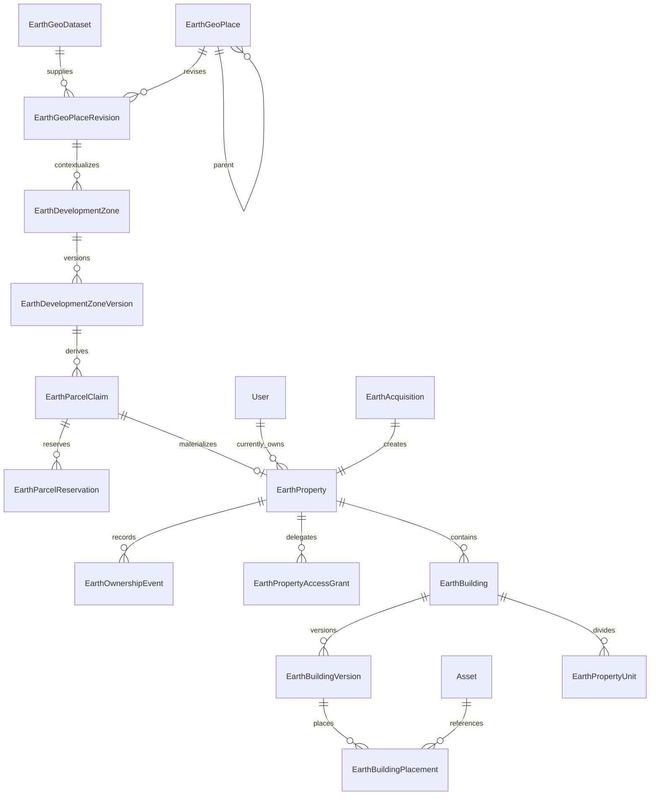

# SIMVERSE Earth - Database Design

## 1. Status and constraints

This is a conceptual target model. **Phase 1 makes no Prisma or database
change.** The current application remains on SQLite and continues its established
`prisma db push` workflow.

The proposed production Earth store is PostgreSQL with PostGIS. The owner must
approve a dedicated migration plan before schema implementation. PostGIS types,
indexes and constraints must be managed through reviewed migrations; they cannot
be safely introduced as an incidental `db push` change.

## 2. Design rules

- Prefix Earth tables/models or place them in a reviewed database namespace so
  they cannot be confused with existing `World` blueprints.
- Keep stable identities separate from immutable revisions.
- Store geometry in spatial columns, not opaque JSON strings.
- Keep source manifests and bounded configuration as JSON where their shape is
  versioned and validated.
- Store references to Asset/object storage; never store map tiles or model
  binaries in relational rows.
- Use database uniqueness and transaction locks for exclusivity.
- Preserve ownership and acquisition history through restrictive or nullable
  relations rather than cascading account deletion.
- Use current-state columns as query projections; append-only events remain the
  historical authority.

## 3. Conceptual relationship map



The diagram omits search names, import jobs, exclusions and audit relations for
clarity.

## 4. Geography catalog

### `EarthGeoDataset`

One immutable import release or scope.

| Field | Purpose |
| --- | --- |
| `id` | Internal stable ID. |
| `providerKey`, `datasetKey`, `version` | Source identity; unique together. |
| `scope` | Global, country or bounded regional import. |
| `sourceUrl`, `licenseName`, `licenseUrl`, `attribution` | Provenance and display obligations. |
| `publishedAt`, `retrievedAt` | Source chronology. |
| `checksumSha256`, `manifest` | Reproducibility; bounded validated JSON manifest. |
| `status` | REGISTERED, IMPORTING, VALIDATING, STAGED, ACTIVE, SUPERSEDED, REJECTED. |
| `activatedAt`, `supersededAt` | Lifecycle. |
| `createdById`, `reviewedById` | Steward attribution. |

Activation uniqueness is scoped, because different countries may use different
providers. A database constraint or activation transaction ensures only one
active revision for the same configured scope/layer.

### `EarthGeoPlace`

Stable conceptual identity used by URLs, saved selections and history.

| Field | Purpose |
| --- | --- |
| `id` | Stable SIMVERSE place ID. |
| `type` | Normalized country/admin/city/town/locality type. |
| `countryCode` | ISO code where applicable; nullable when unavailable. |
| `canonicalKey` | Stable reviewed key; unique within type/scope. |
| `currentRevisionId` | Search/display projection only. |
| `createdAt`, `retiredAt` | Lifecycle without destructive deletion. |

### `EarthGeoPlaceRevision`

Immutable source-specific state.

| Field | Purpose |
| --- | --- |
| `placeId`, `datasetId`, `revision` | Stable place and exact source version; unique. |
| `sourceFeatureId` | Original provider identity; unique within dataset. |
| `parentPlaceId` | Parent effective for this revision. |
| `canonicalName`, `localizedNames`, `alternateNames` | Validated display/search data. |
| `adminLevel`, `codes` | Provider facts. |
| `labelPoint` | `geometry(Point, 4326)`, required for display. |
| `boundary` | Nullable `geometry(MultiPolygon, 4326)`. |
| `bbox` | Computed envelope or box columns. |
| `boundaryQuality`, `confidence` | Explicit uncertainty. |
| `disputeMetadata`, `sourceProperties` | Bounded reviewed JSON. |
| `contentHash`, `createdAt` | Immutability and verification. |

Recommended indexes include GiST on `boundary` and `labelPoint`, B-tree on
dataset/type/country/parent, and reviewed full-text/trigram indexes on normalized
names. Search names may be normalized into `EarthGeoPlaceName` rows for language
and ranking rather than queried from JSON.

### Import staging

`EarthGeoImportJob` and staging tables hold job status, counts, errors and
quarantined feature references. Staging data is never served as active truth.
Large raw source files and generated vector tiles live in object storage with
checksums, not database blobs.

## 5. Development zones and parcel claims

### `EarthDevelopmentZone`

Stable policy identity with name, status projection, current version and steward
attribution. It may reference a containing `EarthGeoPlace` but is not that
place's boundary.

### `EarthDevelopmentZoneVersion`

Immutable complete zone definition.

| Field group | Fields |
| --- | --- |
| Identity | `zoneId`, `version`, unique pair, `contentHash` |
| Context | `datasetId`, `placeRevisionId`, provenance and review note |
| Geometry | `eligibleGeometry geometry(MultiPolygon,4326)`, exclusion geometry/source refs |
| Metric frame | `projectionDefinition`, optional `projectionSrid`, grid origin, bearing |
| Grid | `algorithmVersion`, `cellWidthMeters`, `cellHeightMeters`, edge rule, coverage threshold |
| Policy | zoning categories, allowed property/template types, limits, visibility |
| Lifecycle | DRAFT/REVIEW/ACTIVE/PAUSED/SUPERSEDED/RETIRED, activation dates |

An active version is immutable. Any geometry/grid/policy change appends a new
version. Existing parcels retain their original version.

### `EarthParcelClaim`

Materialized only when reserved, owned, developed, blocked or retired.

| Field | Purpose |
| --- | --- |
| `id` | Internal row ID. |
| `publicId` | High-entropy/deterministic external parcel ID; globally unique. |
| `zoneVersionId`, `gridColumn`, `gridRow` | Deterministic source; unique together. |
| `algorithmVersion` | Derivation contract. |
| `geometry` | Frozen `geometry(Polygon,4326)`. |
| `centroid` | `geometry(Point,4326)`. |
| `areaSquareMeters` | Server-computed metric area. |
| `state`, `lockVersion` | Current query/concurrency projection. |
| timestamps | Creation and latest state transition. |

The database verifies the unique grid tuple. A content hash verifies the frozen
geometry. Candidate availability not represented by a row is re-derived.

### `EarthParcelReservation`

| Field | Purpose |
| --- | --- |
| `id`, `publicId` | Internal and external identities. |
| `parcelClaimId`, `userId` | Reserved parcel and actor. |
| `status` | ACTIVE, CONSUMED, EXPIRED, CANCELLED. |
| `expiresAt` | Server-controlled expiry. |
| `idempotencyKey` | Unique per user/operation. |
| `eligibilityVersion` | Rule version checked when reserved. |
| timestamps | Audit chronology. |

A partial unique index permits one row with `status = 'ACTIVE'` per parcel.
Application transactions first lock the claim, mark an elapsed reservation
EXPIRED and then create the replacement. Time is read from the database.

## 6. Virtual property and ownership

### `EarthProperty`

A stable virtual property created through acquisition or allocation.

| Field | Purpose |
| --- | --- |
| `id`, `publicId` | Stable internal/public identity. |
| `parcelClaimId` | Unique for land/whole-parcel claims. |
| `propertyType` | LAND, DEVELOPED_PROPERTY or other approved vocabulary. |
| `status` | ACTIVE, SUSPENDED, TRANSFER_PENDING, RETIRED. |
| `currentOwnerUserId` | Current-state projection; proposed v1 owner model. |
| `acquiredZoneVersionId`, `acquiredDatasetId` | Historical location context. |
| `currentBuildingVersionId` | Optional published development projection. |
| `visibility` | PRIVATE, UNLISTED or PUBLIC policy projection. |
| timestamps | Creation/update/retirement. |

Current owner uses `onDelete: Restrict` until account deletion policy is
approved. If regulatory deletion later requires pseudonymization, history uses
a separate retained actor key and audited process rather than cascading away.

### `EarthPropertyUnit`

Units belong to an EarthBuilding, have a stable public ID, unit/floor label,
bounded geometry or local volume, status and optional current owner. Unit
ownership does not imply the right to edit the building exterior or land.

### `EarthOwnershipEvent`

Append-only sequence per property/unit:

```text
ALLOCATED | ACQUIRED | TRANSFERRED | GIFTED | REVOKED | RETIRED | CORRECTED
```

It records previous/new owner references, acquisition/transfer record, rule
version, reason code, effective time and actor. A unique `(propertyId, sequence)`
prevents reordering. No update/delete path is exposed to ordinary services.

### `EarthAcquisition`

Records request ID, user, parcel/property, consumed reservation, acquisition
method, rule version, bounded requirement snapshot, status, idempotency key and
completion/failure reason. It contains in-game facts only; it is not a legal
property contract or payment ledger.

### `EarthStarterAllocation`

Records campaign/rule version, user, property, decision and timestamp. A unique
constraint such as `(userId, programKey, programVersion)` enforces the approved
allowance. Reclaim/inactivity behavior is an unresolved product policy.

### `EarthPropertyAccessGrant`

Resource-level grant independent of workspace role:

```text
VIEW | BUILD_DRAFT | PUBLISH_BUILD | MANAGE_GRANTS | MANAGE_PROPERTY
```

Fields include property, grantee User, granted permissions, grantor, expiry and
revocation. Workspace Asset authorization is still checked separately.

## 7. Construction data

### `EarthBuilding`

Stable identity associated with one property and optional additional parcel
links for approved multi-parcel construction. Tracks status, current draft and
published version projections.

### `EarthBuildingVersion`

Immutable published/draft snapshot:

- building/version unique pair;
- schema version and content hash;
- parcel-local anchor and coordinate-frame version;
- template Asset ID and exact Asset version;
- title/description and bounded customization;
- server-computed footprint `geometry(Polygon,4326)` and height;
- validation result/rule version;
- DRAFT, VALIDATED, PUBLISHED, SUPERSEDED or REJECTED state;
- creator and timestamps.

Draft autosave may use a mutable `EarthConstructionDraft` with `lockVersion` for
optimistic concurrency. Publishing always creates an immutable
EarthBuildingVersion.

### `EarthBuildingPlacement`

Stores a placed object within one BuildingVersion:

- stable placement identifier within the version;
- Asset ID + exact AssetVersion;
- role/template category;
- local position, quaternion/rotation and scale;
- server-derived local/world bounds;
- bounded validated customization;
- optional parent placement identifier.

All referenced Assets must be authorized, non-archived, appropriate for use and
licensed for the property's visibility. No binary bytes are copied.

### `EarthBuildingParcel`

Explicit join for every parcel covered by a building, including relationship and
footprint intersection. Publication locks all participating claim rows in a
stable order to prevent concurrent overlap.

## 8. Existing SIMVERSE relationships

Proposed additions to existing models are relations only when implementation is
approved:

- `User`: owned properties, reservations, grants and created revisions;
- `Workspace`: optional authoring context and Asset/catalog publication;
- `Asset`/`AssetVersion`: immutable building templates and placements;
- `World`/`WorldVersion`: optional authored environment binding, never geographic
  authority;
- `SimulationRun`: no direct mutable FK. Future input snapshots copy immutable
  Earth binding metadata.

Do not overload `Entity` for parcels, property claims or places. An Entity may
later reference a property as simulation content, but property exclusivity and
spatial integrity require dedicated records.

## 9. Spatial columns and indexes

Recommended PostgreSQL structures:

- GiST indexes on active place boundaries, zone geometry, parcel geometry,
  centroids and published building footprints;
- B-tree indexes on hierarchy, status, owner, zone grid tuple and timestamps;
- full-text/trigram indexes for normalized place names;
- check constraints for latitude/longitude, positive sizes and valid status;
- `ST_IsValid` import checks and reviewed repair/quarantine rather than hidden
  mutation;
- server-computed `ST_Area`, `ST_CoveredBy` and `ST_Intersects` validation;
- optional PostGIS exclusion constraints where arbitrary footprints must not
  overlap, after performance proof.

Canonical geometry uses SRID 4326. Measurement operations transform to the
zone's recorded metric frame. Geometry APIs use parameterized queries.

## 10. Prisma and PostGIS

Prisma remains useful for users, ownership, versions and ordinary relations.
PostGIS geometry may require `Unsupported("geometry...")` fields and a small
Earth repository using parameterized `$queryRaw`/`$executeRaw` or a reviewed
typed SQL layer. Spatial SQL stays isolated under
`src/server/repositories/earth/`; route handlers and UI never issue it.

The implementation proof must establish:

1. generated Prisma Client remains usable with spatial columns;
2. migrations install PostGIS and create indexes/constraints reproducibly;
3. local, test and CI PostgreSQL environments match production extensions;
4. SQL injection tests cover identifiers, search and geometry input;
5. transaction behavior is tested under real concurrent connections.

Do not encode geometry as JSON merely to avoid this boundary.

## 11. Transaction protocols

### Reservation

```text
BEGIN
derive and validate parcel from immutable zone version
INSERT parcel claim ON CONFLICT DO NOTHING
SELECT parcel claim FOR UPDATE
expire elapsed ACTIVE reservation
reject owned, blocked, retired or actively reserved parcel
evaluate/recheck reservation eligibility
INSERT ACTIVE reservation with idempotency key
COMMIT
```

### Acquisition

```text
BEGIN
resolve prior response by idempotency key, if any
SELECT parcel claim and reservation FOR UPDATE
require unexpired reservation owned by caller
recheck acquisition eligibility and rule version
INSERT acquisition + property
INSERT ownership event sequence 1
UPDATE parcel claim to OWNED
UPDATE reservation to CONSUMED
COMMIT
```

Exactly one concurrent request can move a parcel to owned. Losing requests
receive a stable conflict response and no partial property/history rows.

### Construction publication

Lock the property and all parcel claims in sorted ID order, verify the expected
draft revision, resolve every AssetVersion, recompute the footprint, validate
zoning/bounds/overlap, insert the immutable version, update the current
projection and commit. External storage work occurs before or after the short
transaction through idempotent jobs, not while locks are held.

## 12. Migration path

1. Inventory every current SQLite type, relation and data volume.
2. Approve PostgreSQL version, PostGIS version and migration tooling.
3. Create reproducible local/test PostgreSQL environments on stable C: or remote
   infrastructure; do not use the unstable D: drive.
4. Establish a baseline migration for the existing schema and PostGIS extension.
5. Write and test SQLite-to-PostgreSQL conversion in disposable databases.
6. Compare row counts, content hashes, auth behavior and the complete existing
   test baseline.
7. Rehearse backup, cutover and rollback with a maintenance window.
8. Only then add Earth tables through reviewed migrations.

Whether to migrate the whole platform database or operate a separate Earth
database is an open architecture decision. The recommendation is one
PostgreSQL cluster/database initially to preserve transactional relations and
avoid distributed consistency. Heavy import/tile jobs can scale independently.

## 13. Retention and deletion

- Supersede geography and building revisions; do not edit them in place.
- Preserve acquisition and ownership events under an approved retention policy.
- Expire reservation tokens and minimize stored eligibility details.
- Remove or pseudonymize personal fields through a dedicated account lifecycle;
  never cascade-delete shared property history accidentally.
- Object-store raw imports and tiles under dataset-version retention rules.
- Audit administrative corrections and moderation actions.
