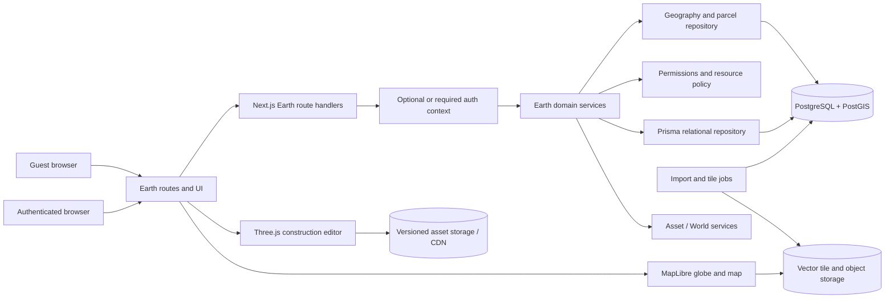

# SIMVERSE Earth - System Architecture

## 1. Architecture status

This document records a **proposed** implementation architecture for owner
review. The integration constraints and Phase 1 exclusions are approved; no
Earth code, dependency or schema exists at this checkpoint.

## 2. Repository audit

The committed baseline is a Next.js 16.3 App Router application using React 19,
TypeScript 7, Prisma 7.10, SQLite through `better-sqlite3`, Zod 4 and Three.js
0.186. The application is a server-authorized modular monolith:

```text
Page or client component
  -> Route Handler
  -> requireApiContext
  -> domain service
  -> membership / resource authorization
  -> Zod validation
  -> Prisma
```

Vitest uses an isolated SQLite database created through `prisma db push`.
Production-style features currently use the same relational schema and keep
large binaries behind safe references.

### Reuse assessment

| Existing capability | Reuse decision | Earth use |
| --- | --- | --- |
| User, Session, login/register | Reuse | Authentication and stable player identity. |
| WorkspaceMember + permission matrix | Extend | Workspace Asset/design access. Property ownership also needs resource ACLs. |
| Safe NotFound strategy | Reuse | Avoid leaking private properties, drafts and Assets. |
| Route -> service -> Prisma boundary | Reuse | All Earth writes follow the current server-authorized pattern. |
| Zod boundary validation | Reuse | Validate search, viewport, parcel, reservation and construction commands. |
| AuditLog | Extend | Dataset activation, reservation, acquisition, transfer, grant and publication events. |
| Asset + immutable AssetVersion | Reuse/extend | Version-pinned building templates, props, materials and previews. |
| World + immutable WorldVersion | Integrate, do not overload | Optional authored environment or simulation context; not the global geography store. |
| SimulationRun snapshots | Extend later | Freeze Earth property/build/geography bindings when a Run uses them. |
| Three.js loader/cleanup patterns | Extract and reuse | Building preview/editor, model loading, camera and resource disposal. |
| Battle ThreeViewerRenderer | Do not reuse directly | It is event-playback and arena-specific. Earth needs a separate renderer. |
| Public sharing projection | Reuse pattern | Future public-safe property projections, never internal records directly. |
| SQLite + `db push` | Keep for current baseline only | Insufficient for authoritative spatial queries and production concurrency. |
| Runtime Protocol v1 | Preserve | Battle-only v1 remains unchanged; Earth binding requires a future protocol version. |

## 3. Recommended system shape

Start Earth inside the existing Next.js repository as a bounded module. Keep
the business rules in services and repositories so high-volume tile generation
or ingestion can later move into workers without rewriting the product.



### Proposed source layout for implementation

```text
src/app/earth/                         public Explore and authenticated flows
src/app/api/earth/                     thin Route Handlers
src/components/earth/map/              MapLibre client components
src/components/earth/construction/     Three.js editor components
src/lib/earth/contracts/               Zod command and public projection schemas
src/lib/earth/geography/               coordinates, hierarchy, provenance types
src/lib/earth/parcels/                 deterministic parcel-key and geometry rules
src/lib/earth/construction/            scene and validation contracts
src/server/services/earth/             domain orchestration and authorization
src/server/repositories/earth/         Prisma and parameterized PostGIS access
src/server/jobs/earth/                 import, validation and tile build jobs
test/fixtures/earth/                    small licensed/synthetic conformance data
```

This is a future layout, not a request to create empty implementation folders in
Phase 1.

## 4. Technology evaluation

### MapLibre GL JS - proposed for Earth exploration

**Fit:** MapLibre is designed for interactive vector-tile maps, style layers,
feature picking, zoom-dependent rendering and web delivery. Its globe/map
presentation is a better fit for geographic exploration than building a global
map engine from raw Three.js primitives.

**Use it for:** globe and map navigation, administrative boundaries, locality
labels, development-zone overlays, parcel outlines, availability and owner
indicators.

**Do not use it for:** authoritative geometry, ownership decisions or final
building editing. Client features are visual projections of server data.

**Validation gate:** before adoption, prove globe projection, antimeridian
behavior, accessibility overlay, mobile memory, custom parcel layers and a
Three.js editor handoff on supported browsers. Pin the actual package version
only after that proof; Phase 1 does not install it.

### Three.js - retained for construction

Three.js is already present and proven for GLTF/GLB loading, fallback visuals,
camera control, animation and cleanup. A new `EarthConstructionRenderer` should
reuse general loader/cache/disposal ideas while keeping Battle choreography and
simulation playback out of the editor.

The editor operates in a parcel-local metric coordinate frame. A single tested
transform service converts WGS84 map locations to the local East-North-Up frame
and back for the saved site anchor. The browser may preview bounds; the server
recomputes footprints and validates publication.

### PostgreSQL + PostGIS - proposed production data foundation

SQLite is appropriate for the current local baseline but lacks the required
spatial types, indexes, topology functions and production write-concurrency
controls. PostgreSQL with PostGIS should become the authoritative database
before reservations or acquisition are enabled.

PostGIS supplies:

- `geometry` and `geography` types;
- GiST/SP-GiST spatial indexes;
- containment, intersection, area and distance operations;
- coordinate transformation and simplification;
- vector-tile generation support;
- transaction and row-lock behavior suitable for exclusive claims.

**Migration gate:** SIMVERSE currently has no committed migration history and
uses `prisma db push`. Earth must not silently change that convention. A
dedicated, reviewed PostgreSQL migration phase must choose and prove a migration
toolchain, backup/restore, data conversion and rollback before production data
moves. See [DATABASE_DESIGN.md](DATABASE_DESIGN.md).

## 5. Bounded contexts

### Geography Catalog

Owns imported source versions, stable place identities, localized names,
hierarchies, label points, optional boundaries, quality flags and attribution.
Only a reviewed dataset revision can become active. It does not decide which
land is available.

### Development Zones

Owns explicit virtual-development eligibility polygons and immutable grid
definitions. A development zone is a SIMVERSE policy object derived from, but
not equivalent to, a country, city or town boundary.

### Parcel Availability

Derives candidate parcels deterministically for a requested viewport or key,
subtracts exclusions, and overlays materialized claim state. It never scans or
stores a world-sized parcel table.

### Property and Acquisition

Owns reservation, eligibility snapshot, idempotent acquisition, current claim,
property/unit identity, access grants and append-only ownership history. It
does not perform real-world conveyancing or payments.

### Construction

Owns drafts, immutable revisions, placed Asset-version references, transforms,
server-computed footprints, validation and publication. It does not alter the
source Asset version.

### Earth Projection

Builds the guest-safe globe overview and authenticated location/map
projections. Guests receive no protected location panel, development-zone or
parcel-availability detail. Internal User, Workspace, Asset and transaction
identifiers are never sent to guests. Owner display follows the future privacy
policy.

## 6. Request and data flows

### Explore

1. The browser loads a small style document and low-zoom vector tiles.
2. A guest search returns only a bounded destination label and opaque intent
   value; it does not disclose protected hierarchy, geometry or availability.
3. Selecting a protected destination starts authentication when needed. After
   authentication, the service authorizes and re-resolves the destination.
4. The authenticated explorer may then load permitted boundary/label tiles,
   hierarchy and child results.
5. At parcel zoom, an authenticated API returns only visible eligible parcel
   projections and materialized status overlays.

### Reserve and acquire

1. Authenticated client submits a stable parcel key and idempotency key.
2. Service re-derives the parcel from the active immutable zone revision.
3. A database transaction locks or creates the parcel claim row.
4. Server expires stale reservation state, checks policy and creates one active
   reservation.
5. Acquisition locks the same row, re-checks eligibility, consumes the
   reservation, creates the property and appends ownership/acquisition events.
6. Audit records safe metadata after the authoritative transaction.

### Build and publish

1. Owner or grantee opens a parcel-local editor.
2. Available templates come from authorized immutable Asset versions.
3. Autosave appends or updates a private draft through optimistic concurrency.
4. Publish sends a full bounded construction document plus expected revision.
5. Server resolves Asset versions, recomputes transforms/footprints and validates
   parcel, height, zoning and permissions.
6. A valid immutable BuildingVersion becomes the current public projection.
7. Map tile/overlay cache invalidation targets only the affected property.

## 7. API principles and proposed surface

All payloads are strict versioned contracts. Pagination and viewport bounds are
bounded. Mutating requests require an idempotency key where retry could create a
duplicate effect.

```text
GET  /api/earth/v1/places/search
GET  /api/earth/v1/places/[placeId]
GET  /api/earth/v1/places/[placeId]/children
GET  /api/earth/v1/tiles/[datasetVersion]/[z]/[x]/[y]
GET  /api/earth/v1/parcels?zone=&bbox=&zoom=
GET  /api/earth/v1/parcels/[parcelKey]
POST /api/earth/v1/parcels/[parcelKey]/reservations
DELETE /api/earth/v1/reservations/[reservationId]
POST /api/earth/v1/acquisitions
GET  /api/earth/v1/properties/mine
GET  /api/earth/v1/properties/[propertyId]
POST /api/earth/v1/properties/[propertyId]/grants
POST /api/earth/v1/properties/[propertyId]/construction/drafts
POST /api/earth/v1/properties/[propertyId]/construction/publish
```

Exact paths remain proposed. Only the globe overview and attribution are public.
Protected location reads, parcel browsing, private reads and all writes require
the current session. The service layer still re-verifies every rule.

## 8. Authorization model

Earth combines two scopes:

1. **Workspace scope:** existing permissions control workspace Assets, Worlds
   and collaborative design material.
2. **Property scope:** owner/grant policy controls reservation, property and
   construction operations independent of active Workspace.

Proposed central permissions are `earth.view`, `earth.acquire`, `earth.build`,
`earth.property.manage` and administrative dataset/zone permissions. A
permission grants the capability to attempt an action; ownership or an explicit
grant is still required for a particular property.

Foreign or private resource identifiers use the current safe NotFound behavior.
Public endpoints return a deliberately small public projection rather than a
database object.

## 9. Performance and delivery

- Generalize boundaries by zoom and cache immutable dataset-version tiles.
- Keep active claim/build overlays small and independently invalidated.
- Use bounding-box and spatial-index filters before expensive geometry work.
- Limit search, child, parcel and property response sizes.
- Load MapLibre and Three.js only on routes that need them.
- Stream or lazy-load 3D assets from object storage/CDN; never proxy arbitrary
  creator URLs into a public map without validation.
- Run imports, topology checks and tile builds as idempotent background jobs.
- Introduce queues/object storage only when the approved implementation phase
  requires them; do not fabricate infrastructure in Phase 1.

## 10. Integration boundaries

- Earth geography is dedicated structured data, not a giant `World.blueprint`
  JSON value.
- An Earth property may later reference a `World`/`WorldVersion` for authored
  simulation context, but neither record becomes the legal or spatial source.
- Building templates reference `Asset` and exact `AssetVersion`; globally
  visible use needs a reviewed publish/license gate.
- A future Run using Earth must snapshot dataset, zone, parcel, property and
  building version identity. Existing Runs and Runtime Protocol v1 remain
  unchanged.
- Public Earth pages follow the `PublicMediaShareV1` lesson: construct a safe
  projection and test that internal identifiers cannot leak.

## 11. Operational and security controls

- Dataset imports are staged, checksummed, validated and activated separately.
- Activation and rollback are audited and never edit an active revision.
- Reservation/acquisition metrics include contention, expiry and idempotent
  retries without logging secret tokens.
- Geometry and construction payload sizes are bounded before expensive work.
- Rate limits, abuse detection and moderation are launch prerequisites for
  public construction, although the current repository has no rate limiter.
- Logs use opaque internal IDs and avoid precise private activity history in
  public telemetry.

## 12. Decisions requiring approval

The architecture cannot move into acquisition implementation until the owner
approves:

- PostgreSQL/PostGIS direction and migration strategy;
- MapLibre technical proof criteria;
- initial dataset providers, license and launch region;
- parcel grid size and local projection rules;
- User ownership plus resource grants;
- acquisition/starter/transfer policy;
- public identity and construction moderation policy;
- global Asset publication and storage approach.

The tracked decisions are in [DECISION_LOG.md](DECISION_LOG.md).
