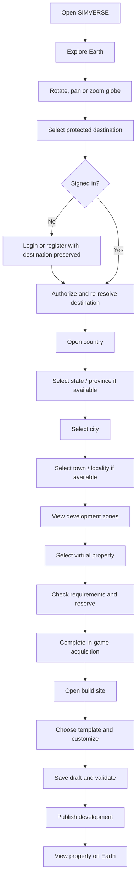

# SIMVERSE Earth - User Journeys

## 1. Experience principles

The Earth experience follows the existing SIMVERSE UX principles: show one
clear next action, use familiar language, disclose limitations, preserve user
work and keep advanced controls progressive.

The map is one way to navigate, not the only way. Every important selection is
also represented by a searchable list, breadcrumb and accessible detail panel.
Availability and ownership use text/icon labels in addition to color.

Every reservation and acquisition step displays the virtual-property notice:

> This is a virtual SIMVERSE property. It does not represent ownership or rights
> in real-world land or buildings.

## 2. Primary journey

The UI skips absent hierarchy levels. A locality with no polygon can still be
selected and centered, but the product explains that development is available
only inside separately approved zones.

## 3. Guest explores Earth

### Entry

The public `/earth` surface opens a globe or a compatible fallback. The guest
can:

- rotate, pan and zoom;
- see the public Earth overview and required source attribution;
- search for a destination name as an entry action, without receiving protected
  location detail or parcel availability;
- select a visible/search destination to begin authentication while preserving
  the intended destination;
- use a list view when WebGL, pointer precision or motion preference makes the
  map unsuitable.

The initial screen does not demand registration before the user understands the
product. It does not expose protected place panels, development zones, parcel
availability or property acquisition controls.

### Selection

Selecting a protected country, region, city, town, locality or development-zone
entry opens the existing login/register flow. The request carries a bounded
destination intent. After authentication, the server authorizes and resolves
the current place revision before opening its detail and child hierarchy.

Authentication never upgrades a point-only locality into a boundary. Once the
location is authorized, its detail panel explains the missing boundary and
shows only its sourced point. No fictional outline appears.

## 4. Guest selects a protected location and authenticates

The guest cannot inspect an available parcel candidate. Authentication starts
when they select a protected location or search destination. Parcel identifiers,
development-zone details, availability and acquisition requirements are returned
only after the authenticated request is authorized.

### Preserving intent

**Proposed design:** create a short-lived `EarthSelectionIntent` on the server
or a signed, bounded state token containing only:

- requested place public ID or normalized search destination;
- safe map camera context needed to restore the view;
- intended return route;
- creation/expiry time and schema version.

The login/register URL carries only the opaque intent ID or signed token.
Untrusted raw coordinates, place IDs, prices or ownership claims are never
restored as authority. After authentication, the server re-resolves and
authorizes the destination. Parcel browsing starts only then. An expired or
unavailable destination returns the user to the nearest permitted Earth view
with a clear explanation rather than silently changing location.

## 5. Authenticated reservation and acquisition

1. The player reviews requirements and selects **Reserve virtual property**.
2. The server atomically rechecks availability and eligibility.
3. On success, the UI shows the reservation expiry using server time and a
   clear next action.
4. The player confirms the in-game acquisition.
5. The server consumes the reservation and creates one property plus ownership
   history in a transaction.
6. The success page links to **Build now**, **View my property** and **Return to
   Earth**.

The confirmation never uses legal purchase/deed language. If a later product
uses virtual currency, its exact amount and requirement version are shown before
confirmation and saved in the acquisition record.

### Contention

If another player wins the reservation first:

- return a conflict without exposing the other account;
- keep the map at the selected location;
- mark the candidate unavailable after refresh;
- offer nearby candidates under the same zone and filters.

Repeated submission with the same idempotency key returns the original success
or stable result and never creates another property.

### Reservation expiry

The player sees an explicit expired state and can retry only after the server
rechecks availability. Client clocks do not decide expiry.

## 6. Starter land

Starter allocation is an approved capability with unresolved rules. The
recommended UX is choice-based:

1. show eligibility and allowance;
2. let the player choose among current eligible candidates;
3. reserve and confirm using the same concurrency path as ordinary acquisition;
4. record the starter program/rule version;
5. prevent a second allocation through a database uniqueness rule.

Do not assign a random parcel without showing location and conditions. Do not
promise permanence, reclaim behavior or transferability until those policies
are approved.

## 7. Property dashboard

`My Earth Properties` lists owned land, developed properties and units with:

- location breadcrumb and map thumbnail;
- virtual property type and state;
- current published development or empty-land state;
- visibility;
- active grants;
- construction draft status;
- acquisition/history entry points.

The detail page distinguishes:

- **Ownership:** who currently holds the virtual property and how it was
  acquired;
- **Build permission:** who may edit/publish;
- **Asset access:** which workspace versions may be used;
- **Visibility:** who can see the development.

## 8. Owner builds

### Open editor

The property owner selects **Build**. The server returns a parcel-local site
contract and authorized template catalog. The Three.js editor shows:

- parcel boundary and required setbacks;
- north/orientation and scale;
- current draft/published development;
- template library with provenance and version;
- position, rotation and allowed customization controls;
- validation messages tied to the affected placement.

### Edit and save

- Selecting a template creates a draft placement only.
- Drag/rotate updates the local preview.
- The UI warns immediately when a local estimate crosses a boundary, but calls
  it a preview until server validation.
- Autosave uses an expected draft version. A concurrent edit conflict presents
  reload/compare options and does not overwrite silently.
- Manual **Save draft** remains available and reports the saved version/time.

### Validate and publish

1. Owner chooses **Validate build**.
2. Server resolves exact Asset versions and recomputes footprint/zoning rules.
3. Errors describe boundary, height, Asset or permission problems without
   exposing foreign records.
4. A clean draft enables **Publish to Earth**.
5. Publication creates an immutable BuildingVersion and updates the map
   projection.

Drafts are private by default. Publication does not mutate the template Asset.

### Mobile behavior

Mobile users can inspect, choose templates, adjust numeric transforms, save and
publish. Complex direct manipulation may switch to a focused full-screen mode
or recommend desktop for precision. The app must not hide unsaved work or offer
controls that cannot function.

## 9. Delegated builder

The owner grants a named SIMVERSE user `BUILD_DRAFT` and optionally
`PUBLISH_BUILD` access. The grantee:

- sees only properties explicitly granted;
- can use only Assets authorized through their workspace/context;
- cannot transfer ownership or manage grants without a separate permission;
- loses mutation access immediately when the grant expires or is revoked;
- never changes the owner's acquisition history.

All grant changes and publication actions are audited.

## 10. Shared visibility

An authenticated viewer authorized to open a developed property sees a safe
projection:

- public property ID and virtual status;
- location breadcrumb and approved map position;
- current published BuildingVersion presentation;
- approved public owner/profile label, if policy allows;
- template/creator attribution required by license;
- the virtual-property notice and report action.

It excludes emails, internal User/Workspace IDs, private drafts, reservations,
eligibility snapshots, access grants and acquisition internals.

Archived, suspended or moderated developments fall back to the safe parcel or
property view according to policy; they do not leak removed content through old
tile caches.

## 11. Developed-property and unit acquisition

### Whole developed property

The detail page separates the virtual land claim, included published build,
transfer conditions and any retained creator/license attribution. The same
reservation/idempotent acquisition path applies.

### Individual unit

The user first opens the Building, then an eligible unit. The UI states exactly
which virtual rights come with the unit. Unit ownership does not grant land,
exterior-edit or common-area rights. A guessed real-world unit layout is never
shown as fact.

Transfers, resale and gifting remain blocked until policy and history tests in
the implementation plan are approved.

## 12. Error and recovery journeys

| Situation | User experience |
| --- | --- |
| Boundary unavailable | Center on label point, disclose limitation, show reviewed zones only. |
| No development zone | Explain that exploration is available but virtual property is not enabled there. |
| Dataset update | Preserve saved property; show current and acquisition-era context where useful. |
| Destination retired during login | Return to the nearest permitted Earth view and explain the change. |
| Session expired | Preserve safe intent/draft identifier, authenticate, then reauthorize/revalidate. |
| Asset archived | Existing published version remains pinned; block new use and explain replacement. |
| Draft conflict | Preserve both versions; require reload/merge choice. |
| WebGL unavailable | Provide the guest globe fallback; authorized users retain permitted list/detail access, and building preview explains device limitations. |
| Network interruption | Retry idempotently and show last confirmed server state. |
| Authorization lost | Stop saves, retain local unsent work temporarily, and explain that permission changed. |

## 13. Accessibility checklist

- One page-level heading and ordered heading hierarchy.
- Search, breadcrumbs and list navigation work without the map canvas.
- Map controls and property features have accessible names.
- Focus moves to the detail panel after a selection and returns predictably.
- Status is communicated by text/icon/pattern, not color alone.
- Motion respects `prefers-reduced-motion`; globe spin is never forced.
- Dialogs trap and restore focus; reservation timers have non-visual text.
- Touch targets and bottom sheets remain usable at 390 px.
- A keyboard user can complete search, select, authenticate, reserve, acquire,
  edit numeric building controls, save and publish.

## 14. Analytics without fabricated product data

Future product analytics may record funnel steps, errors and performance with
privacy review. The UI must not show fake demand, owner counts, values, market
prices or scarcity. Availability and history always come from authoritative
Earth services.
